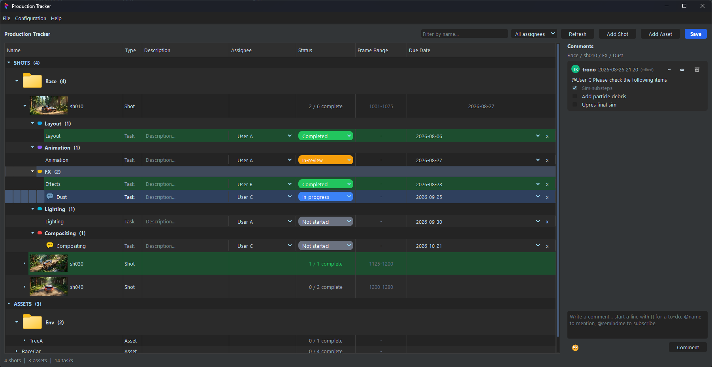
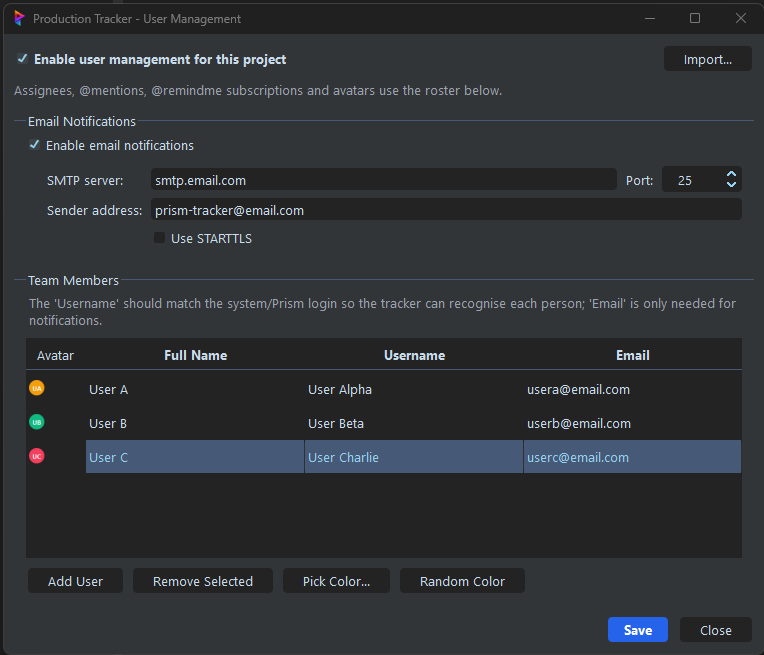
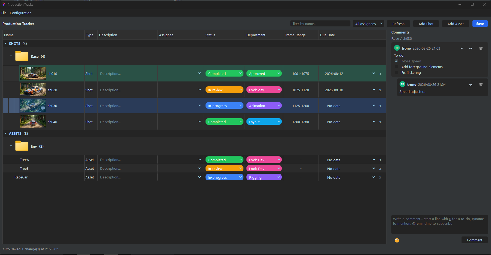

# Production Tracker

[](#version-history)
[](LICENSE)
[](https://prism-pipeline.com)
[](https://www.buymeacoffee.com/tronotrond)

A production tracking plugin for [Prism Pipeline](https://prism-pipeline.com) 2.x.

It adds a spreadsheet-style overview of every shot and asset in a project —
status, assignee, department, frame range, due date — plus threaded comments
with to-dos, @mentions and reminder subscriptions. Everything is stored in the
project itself, so there is no server to run and no database to maintain.

**Latest version: v1.0.4** — see [Version history](#version-history) for what
changed.

> **Status:** used in production here, but this is a personal project rather
> than a supported product, and it has only been exercised against the way one
> studio works. Please try it on a copy or a test project before pointing it at
> live work — see [Before you use it in production](#before-you-use-it-in-production).

### Video introduction

[](https://www.youtube.com/watch?v=PnkbHOPFF20)

*[Prism Production Tracker: Introduction](https://www.youtube.com/watch?v=PnkbHOPFF20)
(YouTube): installation, setup and day-to-day use.*



*Tracking a shot by its Prism departments and tasks: per-task assignees, statuses and due dates, with a threaded comment on the selected task.*

---

## Features

**Tracking**

- **Two modes** (Configuration → Settings): one row per shot, or one row per
  Prism **department and task**, matching the Project Browser's Scenefiles
  tab. See [Tracker modes](#tracker-modes).
- Every shot and asset in one tree, organised the way Prism organises them
  (sequences containing shots, nested folders containing assets).
- Per-entity **status**, **assignee**, **department**, **frame range**,
  **due date** and **description**, each colour-coded.
- **Departments are configurable per project** — add, rename, reorder and
  recolour them (Configuration → Settings). The built-in lists are just the
  defaults.
- Extra **FX layers** can be tracked alongside a shot without creating real
  Prism entities for them.
- Thumbnails from the entity preview, search and assignee filtering, and
  optional row tinting by the assigned person's colour. Thumbnails and row
  tinting each have a toggle under Configuration.
- Add shots and assets from the tracker; they are created in Prism on save.
- **Bulk create**: the Add Shot / Add Asset / Add Task dialogs take as many
  rows as you like. Press **+** to queue another (it inherits the sequence,
  folder or department of the row above, so only the name has to be typed),
  and the trash button drops a row. Duplicates within the batch, and names
  that already exist, are caught before anything is created.
- Right-click anywhere in the tree to add things where you clicked: a section
  or folder offers to create into it (pre-filling the sequence or asset
  folder), a row offers actions on that row.
- Context menu shortcuts to the entity folder, render folder and comp folder.

**Comments**

- Threaded comments per entity, with replies and emoji.
- Markdown-ish `[]` to-do checkboxes that can be ticked off inline.
- `@mentions` and `@remindme` subscriptions — get notified when someone
  replies, when a to-do is completed, or when a status or department changes.
- Unread indicators per entity, tracked per user.

**People and notifications** (optional — see below)

- A team roster stored in the project: full name, login, email, avatar colour.
- Email notifications for mentions, replies and reminders, through any SMTP
  relay.
- A notification log showing every send attempt and its result, so a dead
  relay is visible instead of silent.

**Storage**

Tracker data lives in Prism's own per-entity metadata (`Shotinfo` /
`Assetinfo`), so it travels with the project and is shared by everyone
working on it. Saves re-read the newest data and only write the fields you
actually changed, so two people editing at once do not clobber each other.

---

## Requirements

- Prism Pipeline 2.x (developed against **2.1.3**)
- No third-party Python packages — only Prism's own modules and `qtpy`

---

## Installation

1. Clone or download this repository.
2. In Prism: **Settings → Plugins → add a plugin search path**, and point it at
   the folder that *contains* `ProductionTracker` — that is the repository
   root, not the `ProductionTracker` folder itself.
3. Restart Prism.

A **Production Tracker** menu appears in the Project Browser menu bar with
**Open Tracker** and **User Management**.

The [video introduction](https://www.youtube.com/watch?v=PnkbHOPFF20) walks
through these steps.

---

## User management

User management is **off by default**, and the plugin is fully usable that way.

**Switched off** — comments are posted under your plain Prism username.
Mentions, reminders and notifications are inactive, and `@` is just an
ordinary character in the compose box. The Assignee column, the assignee
filter and per-user row tinting are hidden, since there is nobody to assign
work to. Nothing needs configuring.

Any assignees stored while the feature was on are kept, not discarded, and
reappear if you switch it back on.

**Switched on** — the team roster drives assignee dropdowns, avatars,
`@mentions`, `@remindme` subscriptions and (optionally) email notifications.

To turn it on, open **Production Tracker → User Management** and tick
*Enable user management for this project*. Then add people, giving each one
the **username they log in with**, so the tracker can recognise who is who.



### Email notifications

Inside User Management, tick *Enable email notifications* and fill in the SMTP
server, port and sender address. There is no default relay — notifications
stay inactive until a server is entered. Sending is best-effort and happens on
a background thread: an unreachable relay never interrupts your work, it just
shows up in **Configuration → View Notification Log**.

### Importing people from another project

The roster is per project, so a new project starts empty. Rather than retyping
everyone, press **Import…** and pick *another Prism project folder* — the
plugin finds the tracker data inside it for you. If this project already has
people, you are asked whether to **Merge** (add only people who aren't in the
list yet) or **Replace**. Nothing is written until you press Save.

---

## Tracker modes

The tracker can lay a project out two ways. Pick one under
**Configuration → Settings**.

### One task per shot (default)

Every shot and asset is a single tracked row with its own status, assignee,
department, due date and comments. Best when a shot is one unit of work.



### Use Prism departments and tasks

The tracker groups each shot by its real Prism **departments** and the
**tasks** inside them, the same structure the Project Browser's Scenefiles
tab shows:

```
Studio                        (sequence)
  GenWithStack   Shot   2 / 3 complete   1001-1003
    Lighting                  (department)
      Lighting     Task   In-progress    2026-09-01
    Compositing               (department)
      Compositing  Task   Not started
```

- Each **task** is the tracked row — status, assignee, due date, a task
  description and its own comment thread.
- The **shot** becomes a summary: how many of its tasks are complete, and the
  earliest outstanding due date. Its **description** and **frame range** stay
  editable on that row, since they belong to the shot rather than to a task.
- The **Department** column is hidden, since the tree groups by department
  already.
- FX layers are a shot-mode feature and are not offered here.

This is the mode shown in the screenshot at the top of this page.

Departments and tasks only exist once something has been created in them, so
the tracker shows what is really on disk. To add one, right-click a shot or a
department folder and choose **Add Task…** — it creates a real department/task
folder through Prism, so the Project Browser sees it too. Departments with no
tasks yet are listed too, so you can add their first task.

To undo one, right-click it and choose **Delete Task**, or **Delete
Department** on an empty department. As with deleting a shot, a folder that
holds any files (scenefiles, renders, anything besides the tracker's own task
info) is never deleted from here; the tracker lists what it found and leaves
it to you.

A shot whose tasks are all complete is tinted green, the same way a finished
row is in the other mode.

### Switching modes

The two modes store their data in different places, so switching is lossless
but each mode only shows what was entered in that mode:

| Mode | Tracker fields stored in |
| --- | --- |
| One task per shot | the entity's Prism metadata (`Shotinfo` / `Assetinfo`) |
| Prism departments and tasks | each task's own `info` file, next to the task |

Nothing is deleted when you switch, and per-task data sits alongside whatever
else Prism keeps in that file.

The shot/asset **description** and the shot **frame range** are the exception:
they are Prism's own fields, so both modes read and write the same values. A
task's description is separate and only shown in task mode.

---

## Departments

Departments are purely informational — they are not tied to any Prism
pipeline step — and give leads another read on where a shot or asset actually
is. Shots and assets move through different pipelines, so each has its own
list, and FX layer rows are locked to a single department of their own.

Edit them under **Configuration → Settings**: add, remove, rename, reorder and
recolour. A blank entry is always offered first (meaning "not set"), and
**Approved** is always added as the last entry to mark the end of the
pipeline — you cannot rename, recolour or reorder it, so "finished" stays one
recognisable value across every project. A shot that is both *Completed* and
*Approved* gets the green "fully wrapped up" row tint.

Renaming a department does **not** rewrite shots and assets that already use
the old name. They keep it, and it stays available in their dropdown until you
set them to something else, so editing the list can never quietly change
stored data.

Statuses are deliberately **not** configurable: *Not started, In-progress,
In-review, Completed* and *Not needed* mean the same thing in every project,
which keeps a handed-over project readable.

---

## Where data is stored

| What | Where |
| --- | --- |
| Status, assignee, department, dates, comments (shot mode) | Prism's per-entity metadata (`Shotinfo` / `Assetinfo`) |
| The same fields per task (task mode) | `<task folder>/info.json` |
| Roster, notification settings, departments | `<pipeline>/Configs/ProductionTracker.json` |
| Notification send log | `<pipeline>/Configs/ProductionTracker_NotifyLog.json` |
| "Colour rows by user" preference | Your Prism user config (per user, not per project) |

Every path is resolved by asking Prism, not by assuming folder names, so
projects that have renamed `00_Pipeline`, `Configs` or the render folders work
without changes — including projects you import a roster from.

Nothing is stored outside the project, and there is no global or shared
network location. Copying a project copies its tracker data with it.

---

## What the plugin writes

Worth reading before adding this to an existing project. The tracker keeps
its own settings in its own file, but the per-entity tracking data lives in
Prism's own entity-info files, because that is what makes it travel with the
project and be visible to everyone.

| File | Owner | What the tracker does |
| --- | --- | --- |
| `<pipeline>/Configs/ProductionTracker.json` | the plugin | Its own file: mode, roster, notification settings, departments. |
| `<pipeline>/Configs/ProductionTracker_NotifyLog.json` | the plugin | Its own file: the notification send log. |
| `<pipeline>/Shotinfo/shotInfo.*` | **Prism** | Adds `tracker_*` keys inside each shot's `metadata` block. Frame ranges go through Prism's own `setShotRange`. |
| `<pipeline>/Assetinfo/assetInfo.*` | **Prism** | Adds `tracker_*` keys inside each asset's `metadata` block, and writes the asset's `description` (Prism's own field). |
| `<task folder>/info.*` | **Prism** | Task-mode only: adds `tracker_*` keys for that task. |
| `Documents/Prism2/Prism.json` | **Prism (per user)** | One namespaced `productiontracker` section: the row-colour preference and which comments you have read. Per user, never per project. |

The project config (`pipeline.json`) is **never** written.

### How the shared files are kept safe

- Every key the tracker adds is prefixed `tracker_`, so it cannot collide with
  Prism's own fields or with metadata anyone adds by hand.
- An entity's `metadata` block is written as a whole, so the tracker re-reads
  the file from disk (not from Prism's cache) right before each write and
  only changes that one entity's block. Keys put there by Prism or by another
  tool survive, and other entities are never affected. Each write is read
  back to check it reached the disk; if Prism couldn't write the file (it
  was locked, say), the row stays unsaved and the save is retried.
- Prism's own metadata dialogs (Edit Shot, the asset description dialog)
  rewrite the whole block too, from what they read when they opened. In any
  Prism window that loads this plugin they are guarded: saving one only
  applies the rows you changed in it, so it can't put back an older status or
  description, or turn comments into plain text. The same goes for the asset
  description box, Prism's asset description setter and Prism's shot,
  sequence and episode renames, which all wrote from Prism's cache. Prism
  windows that don't load the plugin (a different Prism install, say) are
  not guarded.
- Comment threads **merge** rather than overwrite, so two people commenting on
  the same entity at once do not clobber each other.
- Other fields merge **field by field**: a save only writes what you changed,
  and takes everything else from what is stored at that moment. Changing a
  due date never puts back an old status that someone else has since
  updated, even if your window has not shown their change yet. FX layers
  merge the same way, layer by layer.
- Only rows that actually changed are written.

### Things to know

- **`Description` is Prism's field, not ours.** The tracker's Description
  column reads and writes the same `Description` metadata Prism itself shows
  and searches on. Editing it in the tracker changes it in Prism. This is
  deliberate, but it is the one field that is not namespaced.
- **Task `info` files.** In task mode the tracker stores task fields in
  `<task folder>/info.*`, which is Prism's file. Prism 2.1.3 defines
  `getTaskData`/`setTaskData` for it but never calls them, so in practice the
  tracker is the only writer. Writes merge into whatever is already there, so
  a future Prism version that starts using the file would sit alongside.
- **Deleting an entity from the tracker** removes its entry from Prism's shot
  or asset info file, and removes the (empty) folder. That is a real deletion
  of Prism data, and it asks first.
- **Concurrency.** If two people change the *same field* of the same row, the
  later save wins and the status bar names the field that was also changed
  by someone else. The entity-info files are rewritten whole rather than
  patched in place, so two saves landing in the very same instant can still
  lose one of them.
- **Seeing other people's changes.** One-task-per-shot mode checks for them
  every few seconds. Task mode keeps each task in its own file, so it checks
  those files' timestamps in the background every 30 seconds; press Refresh
  to see changes sooner. Saving does not depend on this, since every save
  merges against the files as they are at that moment. When a refresh or
  save finds that values changed elsewhere, the status bar lists them.

### Known Prism behaviour to be aware of

**Assets are keyed by name, not by path.** Prism stores asset data under the
asset's name (`getAssetNameFromPath` returns the basename), so
`Characters/Dog` and `Props/Dog` share one record — one status, assignee, due
date and comment thread, in Prism as well as here. The tracker detects this
on open and says which assets are affected; renaming them apart is the only
way to track them separately.

**Episodes are supported** — sequences, shots, frame ranges and Add Shot are
all episode aware, and two shots with the same name in different episodes are
kept apart. See the table below for how far that has been proven.

### Before you use it in production

Prism projects differ more than you might expect — episodes, nested asset
folders, renamed pipeline folders, local files, different Prism versions — and
this plugin has grown around one studio's setup. It is offered in the hope it
is useful, but **you use it at your own risk**, and the licence disclaims
warranty in the usual formal terms.

A sensible way in:

1. **Look before you touch.** Nothing is written until you edit a field and
   Save, so opening the tracker on a real project is safe to browse.
2. **Try it on a copy first**, or on a throwaway project — add a shot, set a
   status, write a comment, delete something, and check Prism's own Project
   Browser still shows what you expect.
3. **Keep a backup of two folders.** `Shotinfo` and `Assetinfo` inside the
   pipeline folder hold everything the tracker touches outside its own file
   (plus each task's `info` file in task mode). Copying those is enough to get
   back to where you started.
4. **Roll it out on one project** before making it part of how everyone works.

What has actually been exercised:

| | |
| --- | --- |
| **Tested against** | Prism 2.1.3 on Windows, projects without episodes, nested asset folders, custom department and task names |
| **Written for but not yet proven in a real project** | episode-based projects — the logic is covered by tests against stubbed Prism responses, not by a real episode project |
| **Not verified at all** | other Prism 2.x versions, macOS and Linux, Prism 1 compatibility mode, projects using Prism's local-files feature |

If something breaks, or your project is laid out in a way the tracker gets
wrong, please open an issue with your Prism version and how the project is
organised — that is the most useful thing you can send.

---

## Version history

### v1.0.4 (latest)

Fixes for statuses and descriptions that sometimes went back to an older
value (for example Completed back to In-progress) while Prism and the
tracker were both open.

- **Fixed:** Prism's own **Edit Shot** and asset description dialogs save the
  whole metadata block they read when they opened, so one left open while
  the tracker saved put the old status, department and description back. It
  also turned comments and FX layers into plain text. The plugin now guards
  those dialogs in every Prism window that loads it: their save only applies
  the rows you actually changed in the dialog, and everything else keeps its
  current value. FX layers already saved as text are read back.
- **Fixed:** Prism's `setAssetDescription` wrote a cached copy of the whole
  asset info file, which could put old values back on other assets. The
  plugin now writes just that one description against the file on disk.
  Prism's asset Edit dialog also opens with the description on disk, and
  only writes it back if you changed it.
- **Fixed:** renaming a shot, sequence or episode in Prism rewrote other
  shots' data from Prism's cache. The cache is now cleared first.
- **Fixed:** a save that Prism silently dropped (the info file was locked or
  couldn't be written) showed as saved, and the old value came back later.
  Every save is now read back from disk. If it didn't land, the row stays
  unsaved, the status bar says so, and it is retried a few times (and again
  with your next change, on Save, or when the tracker is reopened).
  Mention and reminder emails are sent only once the save has landed, so a
  retry never emails twice.
- **Fixed:** saves now read the info file directly instead of through
  Prism's cache, and never modify the cached copy. An unreadable info file
  stops the save instead of being treated as empty.
- **Fixed:** live sync stopped for good once the tracker was closed and
  reopened, and paused whenever a drop-down in the grid had focus. Changes
  made elsewhere could then stay hidden until the next Save, which made it
  look as if Save had changed them. Live sync now restarts when the window
  is shown and only waits while you are typing. It also no longer skips a
  change that lands right after an autosave.
- **New:** the status bar names any values that were changed outside the
  tracker since it last read them, e.g. "SH010: status Completed ->
  In-progress", whether a refresh or one of your saves brought them in, so a
  change from another window or user is easy to tell apart from your own.
- **Fixed:** a stray key press on a Status or Department drop-down that still
  had focus changed its value ("i" picks In-progress). Keys now only open
  the list.
- **Fixed:** Refresh, or Open Tracker on an already open window, within a
  second or two of an edit discarded that edit. Save no longer drops edits
  whose write failed, or new shots/assets Prism could not create (including
  ones that already exist as omitted and weren't restored). Renaming a row
  keeps the unsaved edits on it and on its tasks, also when Prism cancels
  the rename because a file is in use.
- **Fixed:** a stored status that isn't spelled exactly like the tracker's
  (e.g. "completed") or a due date it can't show was saved back as "Not
  started" / no date the next time any row was saved.
- **Fixed:** a comment being written or edited in the side panel was cleared
  by Save, autosave or live sync.
- **Fixed:** saving in User Management switched a task-mode project back to
  one-task-per-shot mode.
- **Fixed:** the tracker now saves and closes when Prism switches project,
  instead of writing pending edits into the new one.
- **Fixed:** renaming a shot could put old values back on other shots (Prism
  renames from its cache; it is now cleared first), and renaming an unsaved
  new row did nothing.
- **Fixed:** an old plain-text note was duplicated the first time its
  entity was saved, and a project department named "Complete" was renamed
  to "Approved".

### v1.0.3

- **Fixed:** deleting a shot or asset, or renaming an asset, could put
  older values back on other shots/assets (status, assignee, department,
  description) if someone else had saved since the tracker last
  refreshed. The shared info file is now read fresh from disk before it
  is written back.

### v1.0.2

- **Task mode:** shots and assets with no tasks yet (including new, unsaved
  ones) no longer disappear from the list, and departments with no tasks are
  shown so their first task can be added.
- **Task mode:** right-click to **Delete Task**, or **Delete Department** on
  an empty department, to undo building out a shot. Folders holding any files
  are never deleted.
- Adding tasks shows a **Working...** dialog with progress instead of the
  window freezing, and only the affected shot is refreshed afterwards. The
  status bar reports how long it took and how much of that was Prism.
- Add Task dialog: a wider task name field, and cleaner add/remove row
  buttons in all the bulk-add dialogs.

### v1.0.1

- **Task mode:** the shot/asset description and frame range are editable on
  the shot row, and shared with one-task-per-shot mode. Task descriptions stay
  per task.
- **Task mode:** Rename and Delete on shot/asset rows; changes by other users
  are picked up in the background every 30 seconds; assignees found only on
  tasks appear in the filter and dropdowns.
- **Safer saving (both modes):** saves merge field by field, so an edit never
  overwrites someone else's newer change to another field. If two people
  change the same field, the later save wins and the status bar says so.

### v1.0.0

- First release.

---

## Support the project

This is built and maintained in my own time. If it saves you some, a coffee is
always appreciated:

<a href="https://www.buymeacoffee.com/tronotrond" target="_blank"></a>

---

## Contributing

Bug reports and pull requests are welcome. Please keep the existing style:
Prism's `@err_catcher` decorators on public methods, no new third-party
dependencies, and paths resolved through Prism's API rather than hardcoded.

---

## Licence

Copyright (C) 2026 Trond Hille.

Released under the **GNU General Public License v3.0 or later** — see
[LICENSE](LICENSE). In short: you may use, study, modify and redistribute it,
and if you distribute a modified version it must also be under the GPL, with
the original attribution intact.

**Commercial licensing:** if you want to use this in a proprietary product
without the GPL's obligations, that is available separately — contact the
copyright holder to arrange terms.

Prism Pipeline itself is licensed LGPL-3.0-or-later by Prism Software GmbH and
is not included in this repository.
